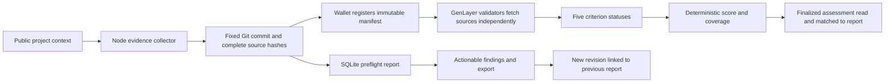

# Genlysis

Genlysis helps GenLayer builders inspect a public build before submission,
find evidence gaps, plan corrections and preserve revision history.

The product provides bounded public-source collection, persistent reports,
a responsive assessment studio, export and revision comparison

The prepared v2 update adds semantic evidence support validation, exact source
line references and independent interpretation checks while retaining the five
axes, weights, report structure and revision workflow

The historical v1 deployment is 0x4BD95131706b77a8100ee38a634a797bE7928715
It is not proof of the corrected v2 source
The current v2.2 replacement contract is deployed and source-verified at
0xa3475354FC960E052D126677ce9E9F52288d3F21
Live v2.2 assessment is verified with accepted consensus and finalized-state readback
The verified result is 65/100 with 85% criterion coverage for one committed-source report
This is an independent readiness result, not official Builder points or a runtime attestation
Matching production publication remains pending
The first live v2 write stored only UNKNOWN criteria
The semantic-evidence-v2.1 response-handling correction is deployed
Two subsequent Undetermined outcomes are documented with finalized-state checks
The prepared semantic-evidence-v2.2 validator independently checks each proposed claim against committed evidence instead of requiring a competing free-form assessment to match
Its replacement deployment is verified and locally configured
The successful receipt and backend readback are preserved in docs/verification/v22-live-assessment.json
See [the v2 remediation record](REMEDIATION-V2.md) for implementation and rollout status

## Deploy on Vercel

Import this repository as a Vite project using Node.js 24.x
Use `npm run build` and output directory `dist`, with this repository as the root
The `api` directory supplies the backend alongside the static frontend
Connect Neon Storage and set `GENLYSIS_CONTRACT_ADDRESS` to the newly verified v2 address
Redeploy after configuring the environment
See [the deployment guide](DEPLOY-VERCEL.md) for the full configuration

## Run locally

Requires Node.js 24 or later.

```powershell
cd D:\Arlos\Desktop\Genlayer\genlysis
npm ci
npm run dev
```

Open http://127.0.0.1:5180/. The backend runs at http://127.0.0.1:4181.
On Windows, double-click `START-GENLYSIS.cmd` in this directory or
`Run-Genlysis.cmd` in the parent Genlayer directory. The launcher opens your
browser, uses the correct working directory and reuses services already running.
Keep its terminal open when it starts new services.
`data/genlysis.sqlite` holds reports and job history. Restarting the app does
not erase completed reports. Jobs interrupted by a restart become failed
with a retry explanation. Keep this directory on persistent disk.

Use the real PatchJury input button or enter another public GitHub repository.
The separate illustrative report is explicitly labeled and contains no
executed assessment or fabricated consensus score.

## Scope and trust boundaries



- Collection accepts public GitHub repositories only. Website URLs are author
  context and are not crawled. User code is never installed or executed.
- File selection is bounded to 6 complete UTF-8 sources, 24 KB per source and
  60 KB total. No truncated source is passed off as a complete file. Files
  exceeding the budget are listed as omitted. A truncated repository tree
  is disclosed separately.
- Technical checks establish specific observations, such as source presence,
  a fixed commit or a reported workflow conclusion. They do not prove runtime
  correctness, security, code ownership or demand.
- Findings distinguish observed problems from missing evidence. Every finding
  gives a correction and a proposed verification step.
- Optional deployment observation asks a fixed StudioNet endpoint for a
  contract schema. It does not bind deployed bytecode to GitHub source or prove
  a complete user transaction path.
- Consensus assesses the selected committed source scope against the embedded
  independent rubric. Registration stores source URLs, content hashes and
  context. Every validator re-fetches and re-hashes sources and independently
  assesses the five statuses. Quotes supporting scored statuses must occur
  verbatim inside an exact line range in a named source
  A separate semantic validation requires substantive support and materially
  compatible reasoning, corrective actions and verification procedures
- The fixed rubric uses fit 25, integration 25, reproducibility 20, resilience
  15 and documentation 15. PASS earns full weight, PARTIAL half, FAIL/UNKNOWN
  zero. Coverage reports evidenced weight. Any unknown blocks readiness;
  any partial or fail requires work. These are proposed independent weights,
  not a calibrated forecast of official points
  Source-only evidence cannot authenticate runtime integration or security tests
  Those two axes are capped at PARTIAL, giving this evidence level a maximum
  of 80/100 without changing the criterion weights
- Consensus agreement does not make qualitative judgment infallible. Evidence
  can make truthful but incomplete claims, omit defects or contain prompt
  injection. No broad security-audit or injection-immunity claim is made.
- Wallet registration is namespaced by wallet and build ID to prevent another
  wallet reserving a report ID. Only that wallet can start its assessment or
  register a linked revision. The wallet is the submitter, not proof of GitHub
  ownership.
- Local revision permission uses a 256-bit capability token stored in the
  originating browser; only its SHA-256 digest is stored in SQLite. It is not
  sent in report share links. Onchain revision permissions use the wallet.
- Anyone with an unguessable report link can read the report. This release
  supports public code and has no private-repository or private-report promise.
- The API verifies finalized contract state, protocol version, full manifest
  equality and assessment commitment before returning an attached assessment.
  A submitted, accepted or failed transaction is never counted as success.

## GenLayer deployment

Deploy the complete file `contracts/genlysis.py` in StudioNet with no
constructor inputs. Preserve its pinned `Depends` line.

After obtaining the deployed address, copy `.env.example` to `.env` and set:

```dotenv
GENLYSIS_CONTRACT_ADDRESS=0xYOUR_DEPLOYED_CONTRACT
```

Restart the backend. The frontend gets its contract configuration from the
same-origin API. A builder can then register the fixed manifest and request
an assessment with an EVM wallet on StudioNet. Both operations wait for
finalized successful execution. Assessment reads are public.

The schema check submits this contract's source to StudioNet's schema service:

```powershell
npm run schema:check
```

The founder explicitly authorized that source submission in this session.
Schema compatibility is not a live deployment or consensus execution test.

## Checks

```powershell
npm test
npm run build
python -m unittest discover -s tests -p "test_*.py"
# Start npm run dev before the following two checks:
node scripts/check-live.mjs
npm run test:ui
```

`check-live.mjs` performs a real public-source analysis of ArlosX/PatchJury.
The Node tests use controlled network fixtures. The Python tests use explicit
GenVM doubles and do not call a live LLM. See TEST-REPORT.md for the delivered
verification and the remaining manual wallet checks.

## Production

```powershell
npm run build
npm start
```

The Node server serves the compiled frontend and API from one origin.
Set `HOST=0.0.0.0`, the assigned `PORT`, an absolute persistent `DATA_DIR` and
the exact public `PUBLIC_ORIGIN` behind a trusted HTTPS proxy. The app currently
limits jobs by connection IP and serializes collection, with bounded queue
length. Do not trust arbitrary forwarded IP headers. A public high-traffic
deployment needs authenticated quotas, retention policy and operational
monitoring before broad promotion.

A static upload of `dist/` alone does not run this backend
The included Vercel adapter uses Neon Postgres and tracked background tasks
Local development continues to use SQLite
Existing local reports are not automatically migrated to the hosted database

Optional `GITHUB_TOKEN` is server-only, never a Vite variable. It is sent only
to api.github.com, never to raw source URLs. HTTP evidence redirects are
rejected. GitHub API rate limits and source availability can still cause
collection failures, which remain visible instead of producing fake scores.

## Design

Original silver and black identity with carbon surfaces, a layered animated
inspection sculpture, floating navigation and a full-width studio. Space
Grotesk and JetBrains Mono are served locally. Decorative motion can be paused
and follows reduced-motion settings. The brand PNG is in `brand/` and
`public/brand/`. The design rationale is in `design-system/genlysis/MASTER.md`.

## Technical references

- https://docs.genlayer.com/developers/intelligent-contracts/when-to-use-genlayer
- https://docs.genlayer.com/developers/intelligent-contracts/features/non-determinism
- https://docs.genlayer.com/developers/intelligent-contracts/features/web-access
- https://nodejs.org/docs/latest-v24.x/api/sqlite.html
